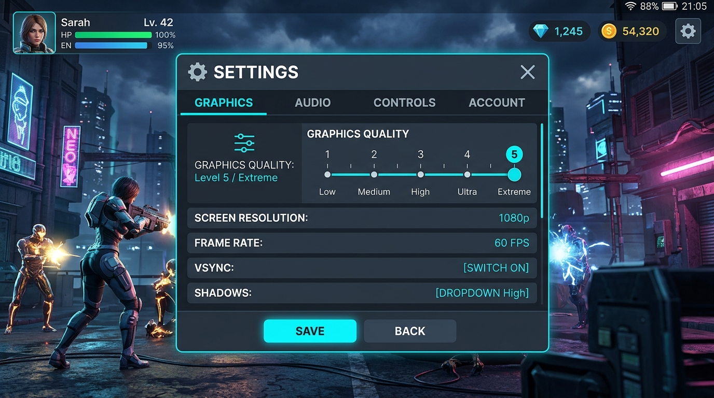

# Bloxstrap Mobile Companion 🚀

> **Roblox Mobile Companion** — Graphics preference guides, performance presets, battery optimization, device thermal diagnostics, and direct Roblox launch bridge.



---

## 📌 Fitur Utama

### 1. 🎛️ Roblox Graphics Settings (`/dashboard/graphics`)
- **Graphics Mode Preference**: Beralih antara mode *Manual* (disarankan) dan *Automatic*.
- **Level Kualitas Grafis (1–10)**: Slider interaktif satu tangan (*one-handed mobile touch*) dan 10 tombol sentuh cepat (`[1]` sampai `[10]`) untuk penyesuaian instan.
- **Simulasi Visual Interaktif (*Real-Time Visualizer*)**: Simulasi rendering grafis Roblox (draw distance dalam studs, pencahayaan, bayangan dinamis, refleksi air, beban termal) dengan 3 pilihan scene (*Sunset*, *Cyber Night*, *Day*).
- **Prioritas Kinerja & Baterai**: Pilihan prioritas *Performance*, *Balanced*, atau *Visual Quality*, serta *Battery Saver* mode.
- **Efek Animasi Companion**: Opsi untuk mematikan animasi UI aplikasi pendamping demi efisiensi daya ponsel.
- **Panduan Manual In-Game**: Bimbingan langkah demi langkah untuk mencocokkan pengaturan di menu in-game Roblox tanpa manipulasi memori ilegal.

### 2. ⚡ Sambung Langsung ke Roblox (*Roblox Bridge*)
- **Protokol Deep-Link Resmi**: Luncurkan aplikasi Roblox Mobile langsung dari companion melalui skema resmi `roblox://`.
- **Experience Quick Launcher**: Masuk ke game populer (*Blox Fruits*, *Brookhaven RP*, *Adopt Me!*, *DOORS*, *Arsenal*, *Tower of Hell*) atau masukkan Place ID kustom Anda.
- **Tautan Akun Pemain**: Tautkan username Roblox untuk menampilkan avatar dan status di dashboard.
- **Salin Nilai Cepat**: Salin konfigurasi rekomendasi ke clipboard dengan 1 sentuhan sebelum membuka game.

### 3. 📂 Preset Manager Terintegrasi
- **5 Preset Bawaan**:
  - *Performance Mode* (Lv. 2): Memprioritaskan kelancaran FPS dan respons sentuh.
  - *Balanced Mode* (Lv. 5): Keseimbangan optimal grafis dan stabilitas perangkat.
  - *Quality Mode* (Lv. 8): Tampilan visual tajam dan pencahayaan dinamis.
  - *Battery Saver* (Lv. 3): Mengurangi beban daya baterai untuk bermain saat bepergian.
  - *Custom*: Profil bebas yang dapat disesuaikan pengguna.
- **Manajemen Lengkap**: Buat baru, edit, gandakan (*duplicate*), dan hapus preset kustom.
- **Validasi Zod & Ekspor/Impor**: Ekspor profil sebagai JSON terstruktur dan impor kembali dengan validasi skema Zod ketat.
- **Isolasi Data Pengguna (RLS)**: Penyimpanan lokal terpisah per profil pengguna.

### 4. 📱 Device Diagnostics & Panduan Termal
- **Metrik Perangkat Keras Nyata**: Membaca alokasi RAM peramban (`navigator.deviceMemory`), CPU cores concurrency, status baterai dan pengisian daya, serta resolusi layar.
- **Evaluasi Tier Otomatis**: Menentukan apakah perangkat Anda *Entry Level*, *Mid Range*, atau *Flagship* dan menyarankan preset yang sesuai.
- **Pencegahan Thermal Throttling**: Panduan mitigasi panas ponsel di Android (bahaya bermain sambil fast-charging, pelepasan casing tebal, manajemen kecerahan layar).

### 5. 🧪 Automated Test Suite (10/10)
- Runner pengujian interaktif bawaan untuk memverifikasi 10 kriteria integritas sistem secara transparan:
  1. Validasi batas slider kualitas (1–10 integer)
  2. Sinkronisasi nilai preset
  3. Penyimpanan dan pemuatan persisten
  4. Reset konfigurasi
  5. Penolakan JSON cacat oleh Zod
  6. Isolasi data pengguna (Multi-tenancy / RLS)
  7. CRUD dan duplikasi Preset Manager
  8. Ergonomi sentuhan mobile (target $\ge 44$px)
  9. Alur panduan manual pada adapter Roblox
  10. Kejujuran status tanpa klaim palsu

---

## 🔒 Kebijakan Keamanan & Transparansi

Bloxstrap Mobile Companion beroperasi secara mandiri sebagai aplikasi pendamping utilitas. Aplikasi ini:
- **TIDAK** menyuntikkan kode berbahaya ke proses game.
- **TIDAK** memodifikasi file internal atau APK Roblox.
- **TIDAK** memanipulasi memori atau melakukan bypass keamanan anti-cheat.
- **HANYA** menggunakan skema deep-linking resmi (`roblox://`) dan memandu pengguna menyetel slider di menu in-game resmi Roblox.

---

## 🛠️ Menjalankan Proyek Secara Lokal

Pastikan Anda telah menginstal **Node.js** (versi 18 ke atas) dan **npm**.

```bash
# 1. Clone repositori
git clone https://github.com/rakhafa73-debug/bloxstrap-mobile-companion.git
cd bloxstrap-mobile-companion

# 2. Instal dependensi
npm install

# 3. Jalankan server pengembangan
npm run dev

# 4. Buka di browser
# Buka http://localhost:3000
```

---

## 🏗️ Teknologi yang Digunakan

- **React 19**
- **TypeScript**
- **Vite**
- **Tailwind CSS v4**
- **Zod** (Validasi Skema Data)
- **Lucide React** (Ikonografi Modern)
- **Google Fonts**: *Outfit*, *Plus Jakarta Sans*, *JetBrains Mono*

---

## 📄 Lisensi
Apache License 2.0
